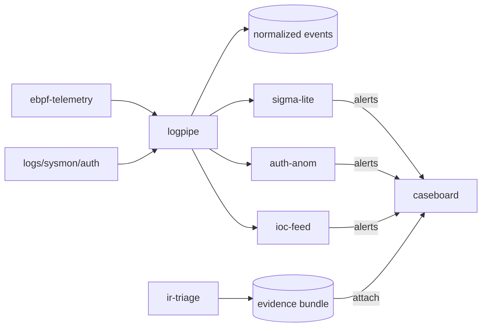

# Blue Team Portfolio Hub

This repository is a documentation and standards hub for a multi-repository
blue team security portfolio.

## What this is

- A roadmap and architecture map for the portfolio
- Shared contracts (event and alert schemas)
- Contribution rules, naming rules, and repo conventions
- Links to all project repositories

## What this is not

- No application source code
- No vendored repositories
- No git submodules

## Architecture

## Repositories

- [REPOS.md](REPOS.md)

## Roadmap

- [ROADMAP.md](ROADMAP.md)

## Architecture details

- [ARCHITECTURE.md](ARCHITECTURE.md)

## Standards

- [standards/event_schema.md](standards/event_schema.md)
- [standards/alert_schema.md](standards/alert_schema.md)
- [standards/naming_conventions.md](standards/naming_conventions.md)
- [standards/logging_style.md](standards/logging_style.md)

## Demo wiring

- [demos/compose/README.md](demos/compose/README.md)

## Contributing

- [CONTRIBUTING.md](CONTRIBUTING.md)

## License

- [LICENSE](LICENSE)
