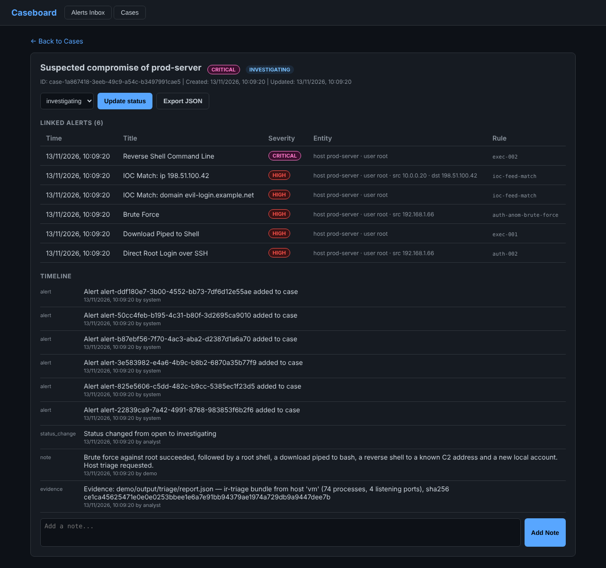
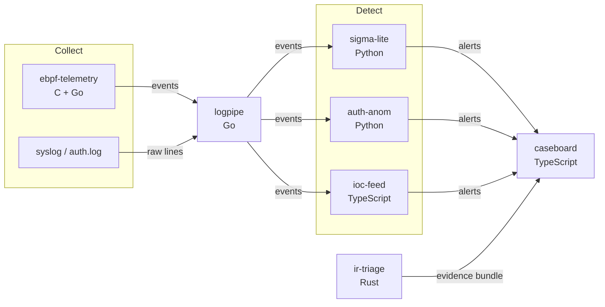

# soc-in-a-box

[](https://github.com/marteinnlundi/soc-in-a-box/actions/workflows/ci.yml)
[](LICENSE)

A small security operations pipeline built from scratch: it collects telemetry,
normalises it, detects attacks, tracks the investigation as a case, and collects
host evidence. Seven tools in five languages, joined by two JSON contracts.

It is a learning and portfolio project. The goal was to build each stage of a
SOC workflow myself instead of configuring an existing SIEM, to understand what
each stage has to do and where the hard parts are.



## Try it

One command runs a simulated intrusion through the whole pipeline and opens the
result in the case management UI:

```bash
docker compose -f demo/docker-compose.yml up --build
# then open http://localhost:3000
```

Without Docker (needs Go, Python 3.10+, Node.js 22+; Rust is optional):

```bash
pip install -r tools/sigma-lite/requirements.txt
./demo/run-local.sh
```

The simulated attacker scans SSH from a known-bad address, brute-forces `root`,
logs in, opens a root shell, pipes a download into bash, starts a reverse shell
to a C2 address and creates a local account. The pipeline raises 38 alerts from
37 log lines and opens one case. See [demo/README.md](demo/README.md) for what to
look at.

## How it fits together



Every tool reads and writes JSON Lines on stdin and stdout, so they compose with
ordinary pipes:

```bash
python3 tools/eventgen/generate.py --scenario brute_force --count 10 \
  | tools/logpipe/logpipe \
  | python3 tools/auth-anom/main.py
```

Two contracts keep the tools independent of each other:
[events](docs/standards/event_schema.md) and
[alerts](docs/standards/alert_schema.md). Any tool can be replaced as long as it
keeps to them. More detail is in [docs/ARCHITECTURE.md](docs/ARCHITECTURE.md).

## The tools

| Tool | Stage | Language | What it does |
|------|-------|----------|--------------|
| [ebpf-telemetry](tools/ebpf-telemetry) | Collect | C (eBPF), Go | Reports every process start and outbound TCP connection on a Linux host from kernel tracepoints. |
| [logpipe](tools/logpipe) | Normalise | Go | Turns syslog and JSON lines into events with one schema. |
| [sigma-lite](tools/sigma-lite) | Detect | Python | Runs YAML detection rules over events. Ships eight rules tagged with MITRE ATT&CK techniques. |
| [auth-anom](tools/auth-anom) | Detect | Python | Stateful detections: brute force, password spraying, impossible travel. |
| [ioc-feed](tools/ioc-feed) | Detect | TypeScript | Loads STIX 2.1 indicators into SQLite and matches IPs and domains in events. |
| [caseboard](tools/caseboard) | Triage | TypeScript | REST API and web UI: alert inbox, cases, timeline, notes, evidence, JSON export. |
| [ir-triage](tools/ir-triage) | Respond | Rust | Read-only host triage: processes, sockets, sessions, persistence, logs, with SHA-256 hashes. |
| [eventgen](tools/eventgen) | Test | Python | Generates synthetic attack logs for tests and the demo. |

## What it detects

| Detection | Tool | Severity | ATT&CK |
|-----------|------|----------|--------|
| SSH authentication failure | sigma-lite `auth-001` | medium | T1110 |
| Direct root login over SSH | sigma-lite `auth-002` | high | T1078.003 |
| Interactive root shell via sudo | sigma-lite `privesc-001` | medium | T1548.003 |
| Download piped to shell | sigma-lite `exec-001` | high | T1059.004, T1105 |
| Reverse shell command line | sigma-lite `exec-002` | critical | T1059.004 |
| Execution from a world-writable directory | sigma-lite `exec-003` | medium | |
| Local account created | sigma-lite `persist-001` | medium | T1136.001 |
| Outbound connection to a suspicious port | sigma-lite `net-001` | medium | T1571 |
| Brute force (many failures, one account) | auth-anom | high | T1110.001 |
| Password spraying (many accounts, one source) | auth-anom | high | T1110.003 |
| Impossible travel (one account, two countries) | auth-anom | medium | T1078 |
| Known-bad IP or domain | ioc-feed | by feed confidence | |

## Repository layout

```text
tools/              one directory per tool, each with its own README and tests
tests/integration/  full-pipeline tests that run the real tools together
demo/               Docker Compose demo and the script that drives it
docs/               architecture, roadmap and the event and alert contracts
.github/            CI for every tool, the pipeline and the demo
```

## Development

```bash
make test    # every test suite
make lint    # gofmt, ruff, rule validation, rustfmt, clippy
make help    # all targets
```

CI builds, lints and tests every tool, runs the full pipeline, loads the eBPF
programs into the runner's kernel, and runs the Docker Compose demo end to end.
See [CONTRIBUTING.md](CONTRIBUTING.md).

## Limits

This is a lab, not a product. In particular:

- caseboard has **no authentication** and listens on loopback only. Do not expose it to a network.
- The detections are deliberately simple and tuned for the synthetic data. They would be noisy on a real network.
- logpipe understands sshd and sudo syslog lines; everything else passes through as `unknown`.
- Detection state lives in memory, and nothing here is built for high volume.

Planned work is in [docs/ROADMAP.md](docs/ROADMAP.md). To report a security
problem, see [SECURITY.md](SECURITY.md).

## License

Copyright (c) 2025-2026 Marteinn Lundi.

Licensed under the [PolyForm Noncommercial License 1.0.0](LICENSE): you may use,
change and share this software for any noncommercial purpose. Commercial use
needs separate permission from the author.

One file is an exception. `tools/ebpf-telemetry/bpf/telemetry.bpf.c` is dual
licensed MIT or GPL-2.0, because the Linux kernel only lets GPL-compatible eBPF
programs call the helpers it uses. See [NOTICE](NOTICE).
