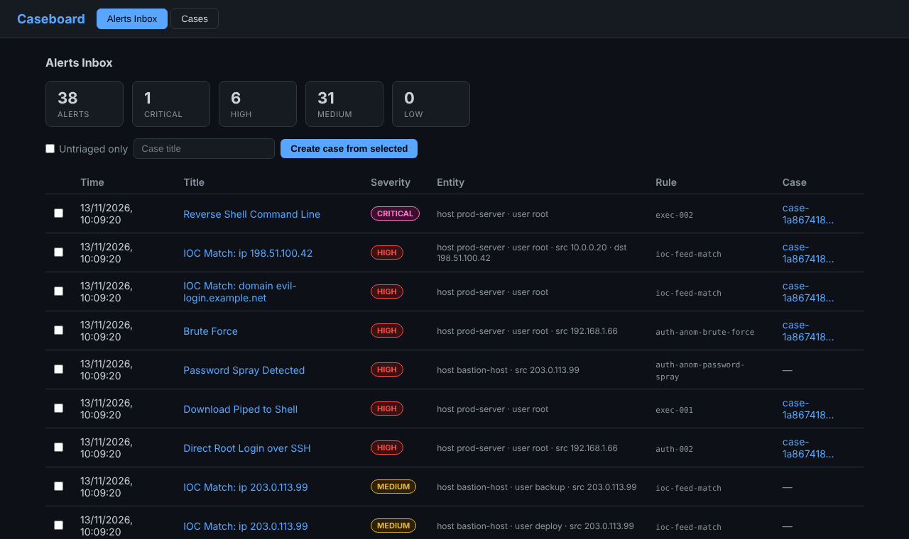

# caseboard

Case management for alert triage: a REST API with a small web UI. Alerts come
in from the detection tools, an analyst groups them into cases, and each case
keeps a timeline of what was linked, noted, attached and decided. TypeScript,
Express and SQLite on Node.js 22+.



## Run

```bash
npm ci
npm run build
npm start          # http://127.0.0.1:3000
npm run dev        # the same, restarting on changes
```

| Variable | Default | Meaning |
|----------|---------|---------|
| `PORT` | `3000` | Listening port |
| `HOST` | `127.0.0.1` | Listening address |
| `CASEBOARD_DB` | `caseboard.db` | SQLite database file |

Or with Docker: `docker build -t caseboard . && docker run -p 127.0.0.1:3000:3000 caseboard`.

## Security

**There is no authentication.** Anyone who can reach the port can read and
change everything, which is why the default address is loopback. Do not expose
caseboard to a network without putting an authenticating proxy in front of it.

What is in place:

- All input is validated: required fields, allowed severity and status values, length limits, 256 kB body limit.
- All SQL uses bound parameters.
- The UI builds the page with `textContent`, never `innerHTML`, so alert text cannot inject markup.
- A Content-Security-Policy allows only the UI's own script and stylesheet (no inline code), and framing is denied.

## API

All bodies and responses are JSON.

| Method | Path | Purpose |
|--------|------|---------|
| `GET` | `/api/health` | Liveness check |
| `POST` | `/api/alerts/ingest` | Store one alert ([alert schema](../../docs/standards/alert_schema.md)) |
| `GET` | `/api/alerts` | List alerts, most severe first. `?untriaged=true` hides alerts already in a case |
| `GET` | `/api/alerts/:id` | One alert |
| `POST` | `/api/cases` | Create a case: `{title, severity?, tags?, alertIds?}` |
| `GET` | `/api/cases` | List cases |
| `GET` | `/api/cases/:id` | Case with its alerts and timeline |
| `PATCH` | `/api/cases/:id` | Change `title`, `severity`, `status` or `tags` |
| `POST` | `/api/cases/:id/alerts` | Link an alert: `{alertId}` |
| `POST` | `/api/cases/:id/notes` | Add a note: `{content, author?}` |
| `POST` | `/api/cases/:id/evidence` | Attach an evidence reference: `{ref, description?}` |
| `GET` | `/api/cases/:id/export` | Full case as one JSON document |

Case status moves through `open`, `investigating`, `resolved`, `closed`. Linking
an alert, changing status, adding a note and attaching evidence each add a
timeline entry.

```bash
curl -s -X POST http://127.0.0.1:3000/api/alerts/ingest \
  -H 'Content-Type: application/json' \
  -d '{"alert":{"time":"2026-01-13T15:32:10Z","title":"Brute Force","severity":"high"},"rule":{"id":"auth-anom-brute-force"},"host":{"name":"prod-server"}}'
```

The stored alert gets a new id from caseboard and keeps the full original
document in `raw`.

## Tests

```bash
npm test
```

The API tests run against an in-memory database. They also check the security
headers and that the UI contains no inline script, inline style or HTML sink.

## Layout

```text
src/server.ts          entry point
src/app.ts             Express app, security headers, error handling
src/router.ts          API routes and validation
src/db.ts              SQLite schema and queries
src/public/            the UI: index.html, app.js, style.css (no build step)
```

## Limits

- No users, roles or audit of who did what; `createdBy` is a label, not an identity.
- Evidence is a reference (a path or URL) and a description, not an upload.
- No pagination: fine for a lab, not for thousands of alerts.
